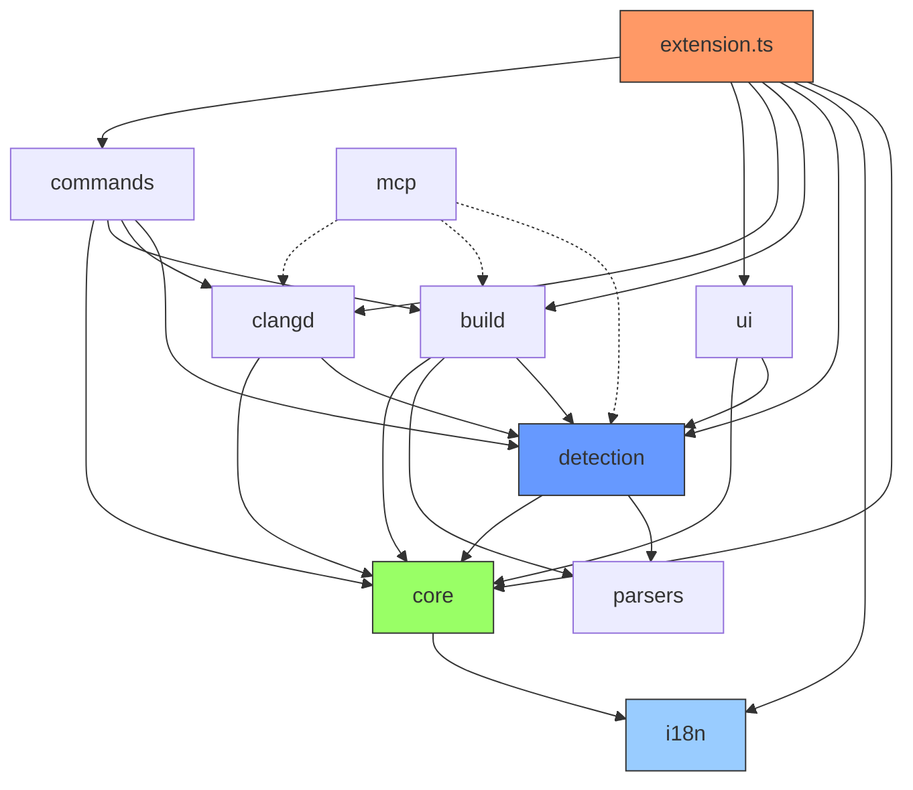

# 依赖图

## 全局模块依赖关系

> 实线 = 直接 import，虚线 = 通过 Handles/Context 间接依赖

## 模块依赖矩阵

| 被依赖 → 依赖 ↓ | core | i18n | detection | build | clangd | commands | ui | mcp | parsers | rules |
|:---|:---:|:---:|:---:|:---:|:---:|:---:|:---:|:---:|:---:|:---:|
| **core** | - | ✅ | | | | | | | | |
| **i18n** | | - | | | | | | | | |
| **detection** | ✅ | | - | | | | | | ✅ | |
| **build** | ✅ | | ✅ | - | | | | | ✅ | |
| **clangd** | ✅ | | ✅ | | - | | | | | |
| **commands** | ✅ | | ✅ | ✅ | ✅ | - | | | | |
| **ui** | ✅ | | ✅ | | | | - | | | |
| **mcp** | | | ✅ | ✅ | ✅ | | | - | | |
| **parsers** | | | | | | | | | - | |
| **rules** | | | | | | | | | | - |
| **extension** | ✅ | ✅ | ✅ | ✅ | ✅ | ✅ | ✅ | | | |

## 外部依赖（npm）

| 包名 | 版本 | 用途 | 使用者 |
|------|------|------|--------|
| `vscode` (peer) | ^1.85 | VS Code API | 全部 |
| `@modelcontextprotocol/sdk` | ^1.0 | MCP 协议实现 | mcp/ |
| `chokidar` | ^3.6 | 文件系统监视 | detection/ (可能) |
| `execa` | ^8.0 | 进程 spawn 替代 | build/ |
| `json5` | ^2.2 | JSON5 解析 (.uproject) | detection/uprojectScanner |
| `neverthrow` | ^6.1 | Result 类型安全错误处理 | 多处 |
| `xstate` | ^5.9 | 状态机 | mcp/ (可能) |

## 循环依赖检测

**结论：无循环依赖。**

- 依赖方向严格单向：`extension → 各模块 → core/i18n`
- `core → i18n` 是唯一的基础设施内部依赖
- `commands → {detection, build, clangd}` 是命令层调用服务层，不存在反向引用
- `mcp` 是可选模块，不参与核心循环

## 耦合度分析

| 指标 | 值 |
|------|-----|
| 模块数 | 11 |
| 依赖边 | 16 (import 级别) |
| 最大入度 | core (7 个模块依赖) |
| 最大出度 | commands (依赖 4 个模块) |
| 平均耦合 | 1.45 边/模块 |
| 耦合等级 | **低** — 模块职责明确，依赖方向一致 |
