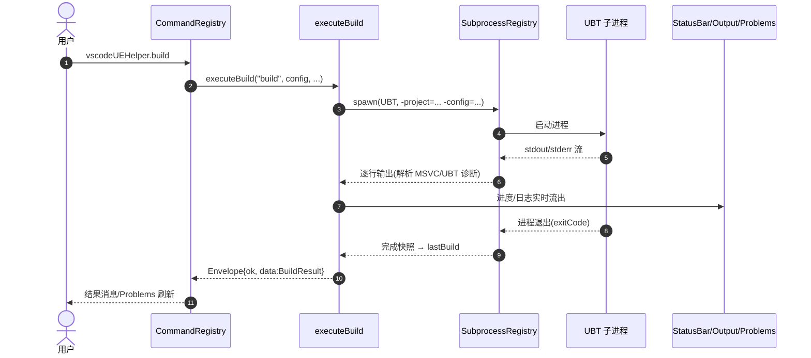
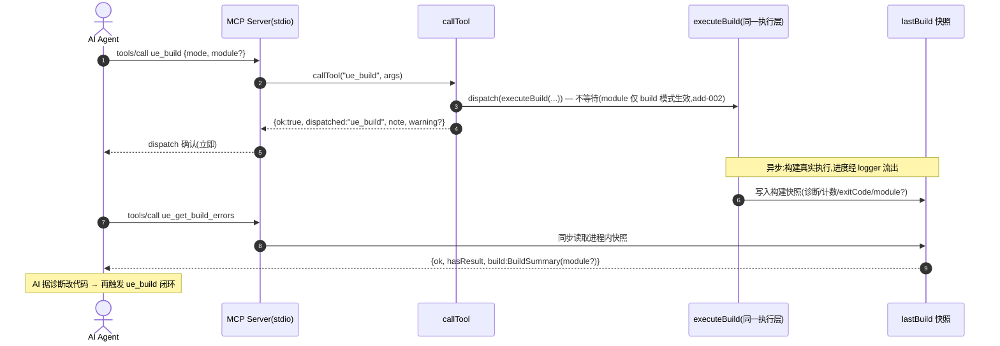
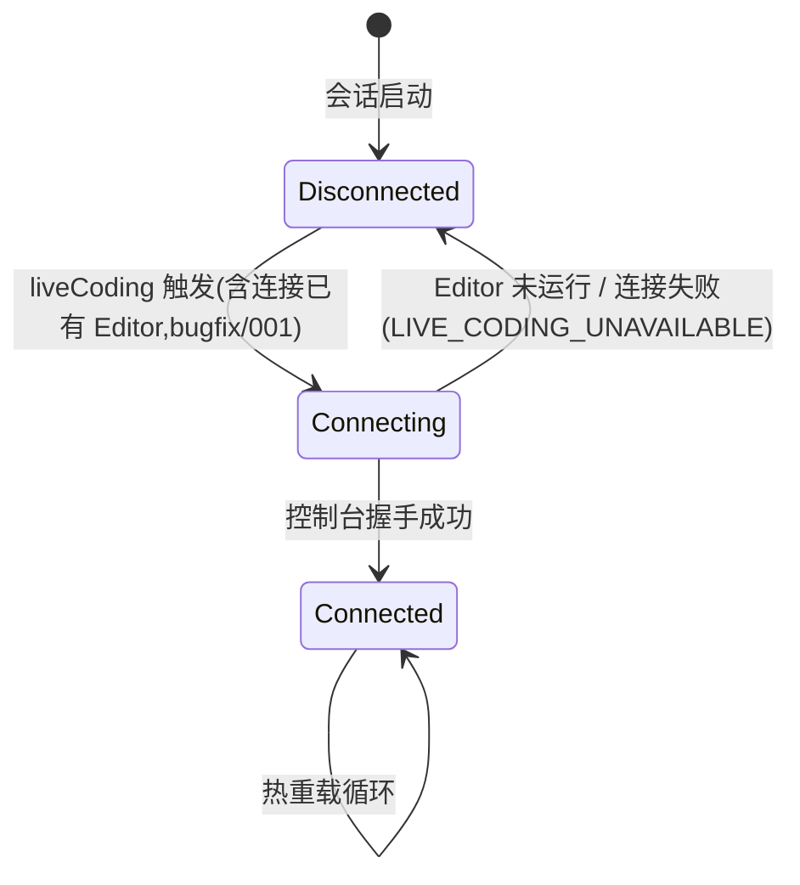

# 事件流程 —— vscode-ue-helper(阶段 1)

> 本文件与 `.planning/context/openapi.yaml` 配套:契约定义操作,本文件定义**组件协作时序**与**关键状态机**。
> 所有参与者与消息均来自代码勘察(src/commands/、src/mcp/、src/build/),无臆测组件。

## 组件协作(sequenceDiagram)

### 场景 1:用户从命令面板触发构建(VSCode 侧,同步等待)

### 场景 2:AI agent 经 MCP 触发构建并回读错误(fire-and-forget + 快照回读)

## 关键状态机(stateDiagram)

### 构建快照(lastBuild,ue_get_build_errors 的数据源)

```mermaid
stateDiagram-v2
    [*] --> NoResult: 会话启动(尚无构建)
    NoResult --> Running: build/rebuild/clean 触发
    Running --> Succeeded: exitCode = 0
    Running --> Failed: exitCode ≠ 0
    Succeeded --> Running: 再次触发
    Failed --> Running: 再次触发
    note right of NoResult: ue_get_build_errors 返回 hasResult=false
    note right of Running: 进度经 logger 流出;MCP 侧 dispatch 已返回
    note right of Failed: 快照含结构化诊断(文件/行/错误码)
```

### Live Coding 连接(Windows)

## 事件消息契约

> 本插件**无跨进程领域事件总线**。两侧消息面为:VSCode 内部 EventEmitter(进程内 UI 通知)
> 与 MCP JSON-RPC 请求/响应(进程间)。下表如实登记,不虚构领域事件。

| 消息 | 类型 | 发布方 → 订阅方 | Payload | 说明 |
|------|------|----------------|---------|------|
| selection 变更 | vscode.EventEmitter(void) | core/workspace → UI(状态栏/构建命令) | 无(读 workspace 当前值) | config/target 选择变化后 fire |
| projectExplorer 变更 | vscode.EventEmitter(tree 数据) | ui/projectExplorer → 树视图 | 文件树数据 | 文件系统变化后 fire |
| MCP tools/call | JSON-RPC 请求 | AI agent → MCP server | {name, args} | dispatch 类立即应答,同步类等快照 |
| MCP 应答 | JSON-RPC 响应 | MCP server → AI agent | MCPDispatch / BuildSummary | 见契约 /mcp/tools/* |

## 边缘场景

| 场景 | 期望行为 |
|------|----------|
| 工作区无 .uproject 时触发构建 | envelope.ok=false,code=PROJECT_NOT_DETECTED,不打爆栈 |
| UBT 进程被用户取消 | code=OPERATION_CANCELLED,子进程被终止(subprocessRegistry 回收) |
| MCP 未在 Cursor/Claude Code 宿主中启动 | callTool 返回 {ok:false, error:MCP_CONTEXT_NOT_INITIALIZED},不返回 stub |
| ue_get_build_errors 在无构建历史时调用 | 返回 {ok:true, hasResult:false},note 提示先 ue_build |
| ue_build mode=rebuild/clean 携带 module(add-002) | 忽略 module,dispatch 响应带 warning,不报错 |
| ue_build module 名在 target 中不存在 | UBT 构建失败(`Unable to find output items for module`),报错进快照,经 ue_get_build_errors 回读 |
| Live Coding 目标 Editor 已在运行 | 尝试连接已有控制台(bugfix/001 修复的行为),不重复拉起 |
| 构建模式参数非法(ue_build mode 乱写) | 回落默认 build(callTool 现行为),不报错 |
| 同一命令重入(构建进行中再点构建) | 现状由命令层/子进程注册表把关;若未拦截,登记为验证阶段待确认差距 |
