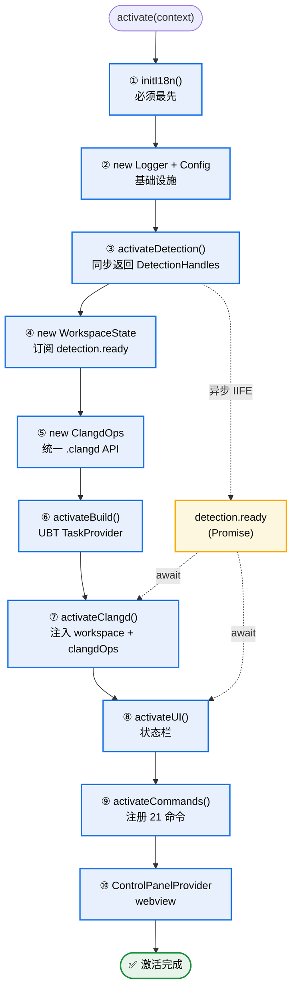
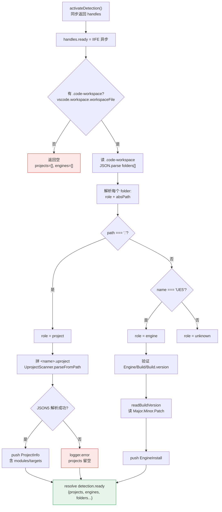
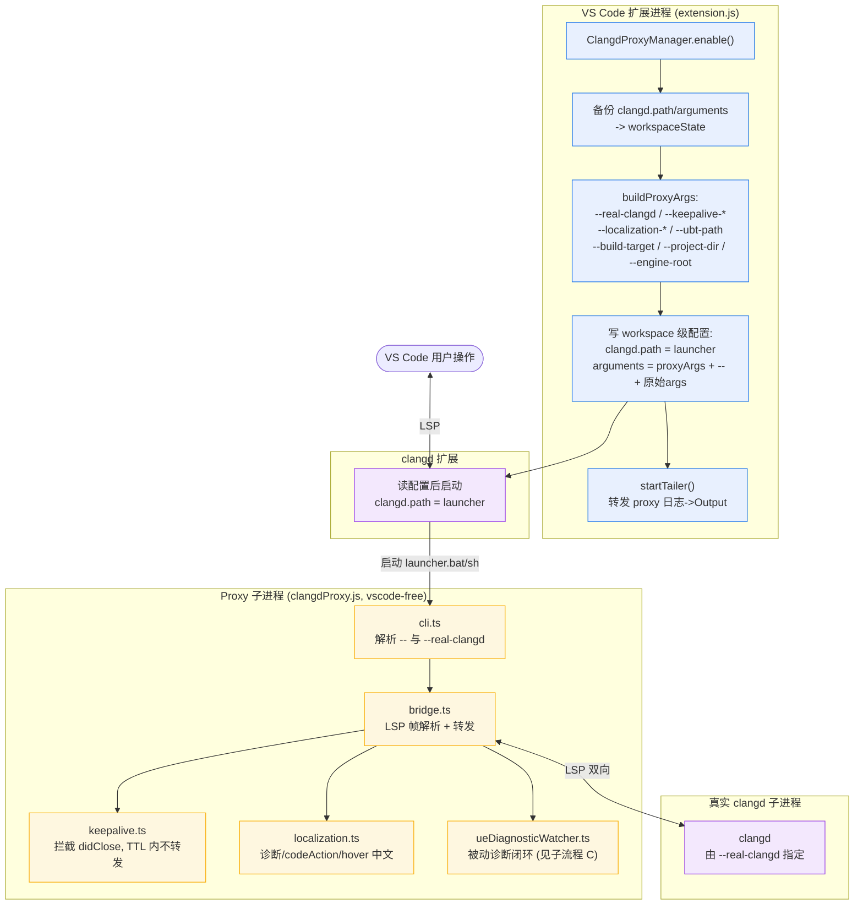
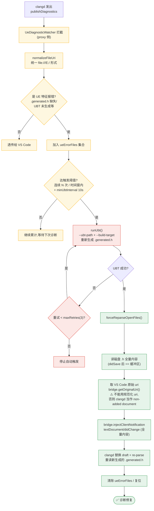
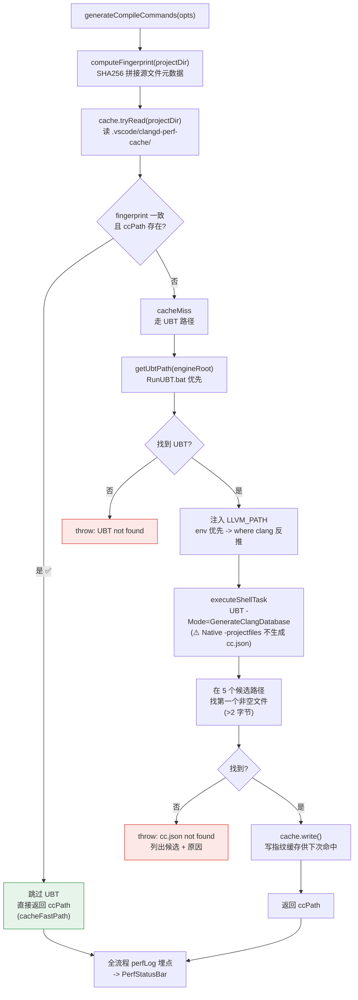
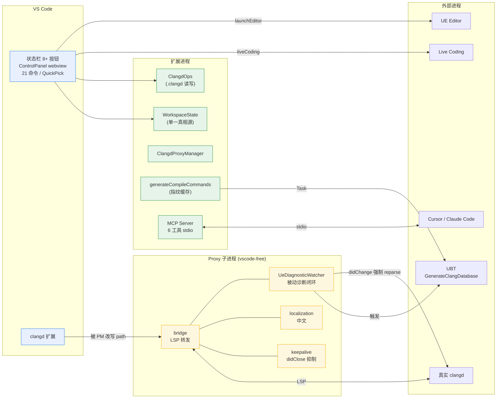

# VSCodeUEHelper 执行流程图

本插件的完整执行流程,按 **激活时序全景** + 四个关键子流程分层呈现。

---

## 一、激活时序全景图

**关键设计**:Promise 驱动的异步解耦。`activateDetection()` 同步返回 handles,但真正的检测在 `handles.ready`(IIFE 异步)里 pre-warm;后续模块(`activateUI`、`activateClangd` 里的 watcher)各自 `await detection.ready` 再拿结果,避免激活期阻塞。

---

## 二、子流程 A:detection 检测层

单一信息源是 `.code-workspace` 的 `folders[]`,硬规则识别角色:`path === '.'` -> project,`name === 'UE5'` -> engine,其余 unknown。

---

## 三、子流程 B:clangd Proxy 启用与运行时架构

核心特色:在 clangd 扩展和真实 clangd 进程之间插入一个**独立子进程 LSP 代理**(`src/clangd/proxy/`,14 个文件,vscode-free)。

**代理插入的三类增强**:
- **keepalive**:拦截 `textDocument/didClose`,TTL(默认 900s)内不转发,抑制 close->reopen 重新索引抖动;退出/`shutdown` 时 `flush()` 补发。
- **localization**:诊断/codeAction/hover 追加/覆盖中文翻译,接入 UE 文档词典。
- **被动诊断闭环**:见子流程 C。

---

## 四、子流程 C:UE 被动诊断修复闭环 ⭐(当前工作主线)

> 设计哲学:**不主动触发 UBT**,只在 clangd 报错时被动响应。proxy 是 vscode-free 进程,UBT 路径/target 由扩展侧解析后通过 CLI 参数传入。

**关键细节**(`src/clangd/proxy/ueDiagnosticWatcher.ts:484`):UBT 跑完后 clangd 不会自动重解析(那些文件不在 main-file body),所以代理主动注入 `didChange` 全量内容强制 re-parse;且必须用 `bridge.getOriginalUri()` 拿到 didOpen 时的原始 uri 形式,否则被 clangd 当作 "non-added document" 拒绝。

---

## 五、子流程 D:compile_commands.json 生成(带指纹缓存快路径)

---

## 六、运行时全景(各模块关系)

---

## 图例

| 颜色 | 含义 |
|------|------|
| 🔵 蓝色 | VS Code 侧 |
| 🟡 黄色 | Proxy 子进程(vscode-free) |
| 🟢 绿色 | 扩展进程核心组件 / 成功路径 |
| 🔴 红色边框 | 错误 / 终止路径 |
| ⭐ | 子流程 C 是最近 5 个 commit 的开发主线 |

## 关键源码索引

| 流程 | 源码位置 |
|------|----------|
| 激活主序列 | `src/extension.ts:26` |
| detection 检测 | `src/detection/index.ts:84` |
| WorkspaceState | `src/core/workspace.ts` |
| ClangdOps | `src/clangd/clangdOps.ts:47` |
| clangd 激活 | `src/clangd/index.ts:101` |
| Proxy 启用 | `src/clangd/proxyManager.ts:148` |
| 设置备份/恢复 | `src/clangd/proxy/settingsManager.ts:82` |
| LSP 桥接 | `src/clangd/proxy/bridge.ts` |
| keepalive | `src/clangd/proxy/keepalive.ts` |
| 被动诊断闭环 | `src/clangd/proxy/ueDiagnosticWatcher.ts:484` |
| compile_commands 生成 | `src/clangd/compileCommands.ts:314` |
| 命令注册(21 个) | `src/commands/index.ts:31` |
| MCP 服务器 | `src/mcp/server.ts:17` |
